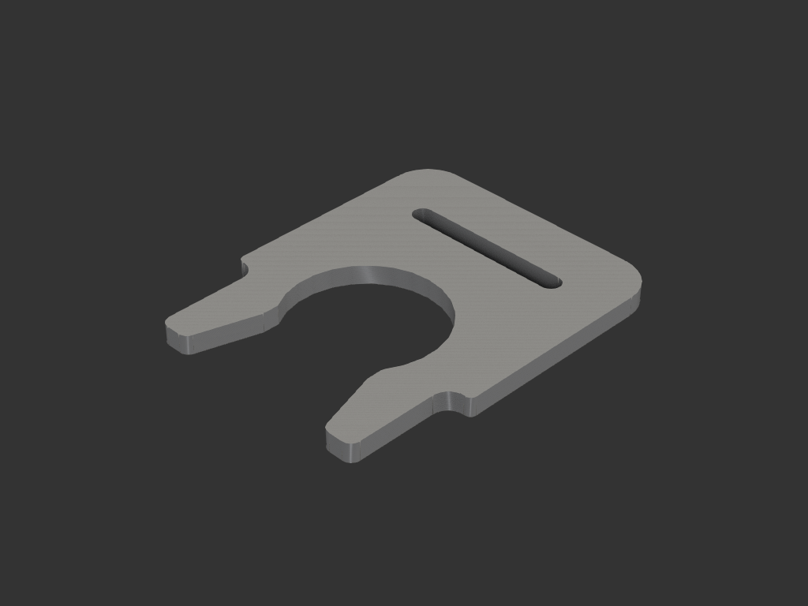
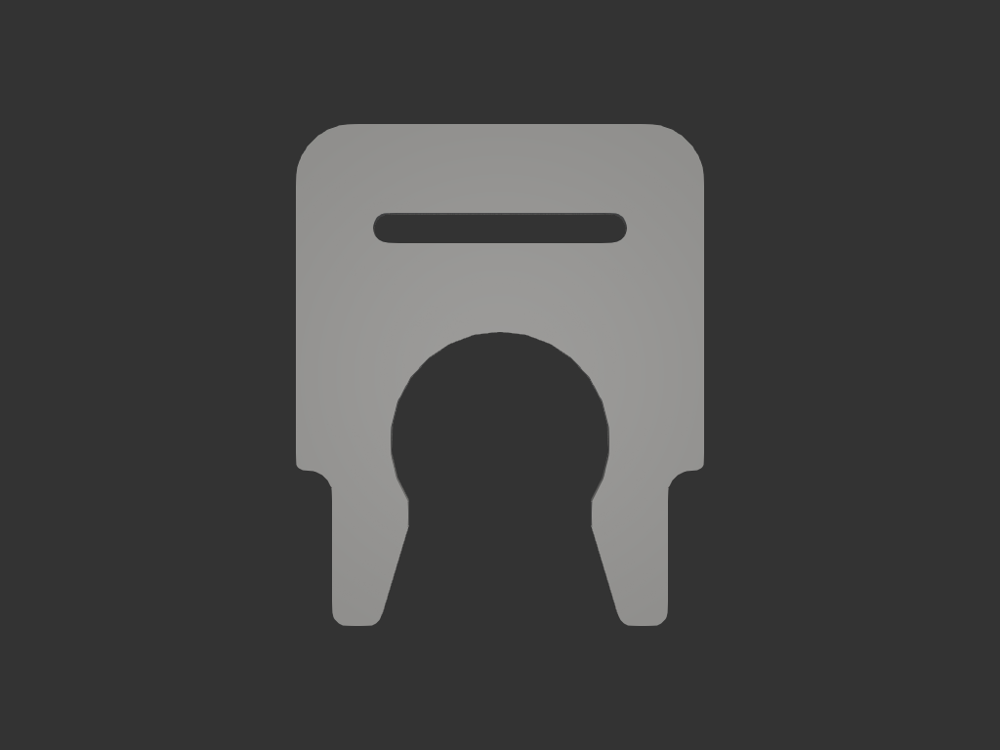

# 정수기호스 안전클립

정수기 호스 퀵커넥트 부속의 목(틈)에 끼워 호스가 빠지지 않게 하는 얇은 ㄷ자 클립.
실물 사출 클립(빨간색)을 참고해 안쪽 모양을 잡았고, 3D 프린트용으로 입구를 넓히고 팔을 얇게 했다.

## 치수/제약

| 항목 | 값 | 근거 |
|---|---|---|
| 클립 두께 `T` | 1.0 mm | 끼워지는 틈 |
| 부속 목 외경 | 7.5 mm | 실측 |
| 구멍 지름 `SLOT_D` | 7.8 mm | 목 + 한쪽 0.15 여유 |
| 입구 폭 `MOUTH` | 6.5 mm | 실물 입구 5.5 보다 넓게 (프린트 재료는 덜 휘므로) |
| 외폭 `W` | 약 14.4 mm | 구멍 + 벽 3.3 × 2 |
| 윗부분 연장 `GRIP` | 4.0 mm | 끼우고 빼기 쉽게 |
| 중심~팔 끝 `BOT` | 6.5 mm | |
| 팔 벽 두께 `ARM_W` | 2.0 mm | 중심 아래만 얇게 (휘는 부분) |
| 윗막대 슬롯 | 9.0 × 1.1 mm | 사진 참고 |
| 둥글림 | 계단 오목 0.9 / 볼록 0.3 / 팔 끝 0.5 | |

## acceptance criteria

- 부속 목(7.5 mm, 틈 1 mm)에 끼워져 딸깍 고정된다 — **사용자가 실제로 끼워 보고 잘 동작함을 확인**
- 입구 쪽이 벌어져 있어 눌러 끼우기 쉽다

## 재료/공정

- 납작하게 눕혀 출력, 서포트 불필요 (층 결이 팔 굽힘 방향과 나란함)
- 레이어 0.12~0.16, 벽 4~5, 인필 무관, 엘리펀트풋 보정
- PETG 권장 (PLA 는 팔이 부러지기 쉬움)

## 결과

## 상태

- 완료 (iter_013). 사용자 출력 후 동작 확인.
